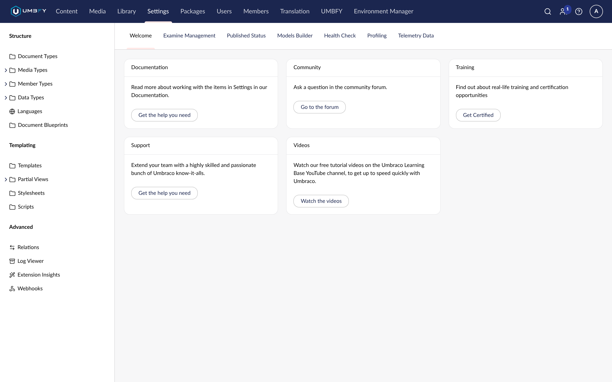

# Content Health

**What it does.** A central view of dependency integrity across the site, with the explicit state of the dependency
index.

**Why and when to use it.** To answer "is the site's reference data sound?" without opening items one by one — and
to check the index state before trusting any other Content Guard answer.

**Where to find it.** The **Content Health** dashboard.

**Required permissions.** Standard Umbraco permissions. Results are scoped to what the user may see. Rebuilding the
index requires an administrator.

**Edition.** **Professional.**

## Index states

This is the most important thing on the page, because every other Content Guard feature depends on it:

| State | What it means | What the guards do |
| --- | --- | --- |
| **Initializing** | First build after installation | Stay cautious — fail closed |
| **Rebuilding** | A rebuild is in progress | Stay cautious — fail closed |
| **Ready** | Normal operation | Trust the index |
| **Unhealthy** / **Failed** | Something went wrong; the last error is recorded | Stay cautious — fail closed |

!!! important "An incomplete index is never reported as healthy"
    Content Guard will not tell you an item is safe to delete, or a page is safe to publish, on the strength of a
    half-built index. When completeness matters, "not sure yet" is the honest answer and the one you get.

On a large site the first build takes a few minutes. That is expected, and you do not need to re-save anything —
see [Installation](installation.md).

## Screenshots

## Step-by-step

1. Open the **Content Health** dashboard.
2. Read the index state first. If it is not **Ready**, read no further conclusions into the numbers.
3. Review the metrics and the problem list.
4. Use the filters to narrow to a problem class.
5. Use the pager for long lists — page numbers and a **Per page** choice.

## Understanding the result

The dashboard reports site-wide dependency problems of the same kinds [Publish Guard](publish-guard.md) checks per
item: missing, trashed, unpublished and culture-specific dependency problems.

Scope matters: an editor restricted to part of the tree sees the health of what they can see. A number on this page
is a number about their scope, not necessarily the whole site.

## Examples

**After a bulk cleanup.** Someone trashed an old campaign section. Content Health shows which surviving pages now
reference trashed items.

**Before a release.** Scan for unpublished dependencies so the release does not go out with gaps.

**After an import.** A content import that did not carry every reference shows up here as missing dependencies,
rather than as a mystery later.

## Rebuilding

If the index is stuck or unhealthy, rebuild it from this dashboard. Rebuild requires an administrator, because it
re-reads the content tree.

Rebuild is **never licence-gated** — [Where Used](where-used.md) is a free feature and cannot work without the
index. See [Rebuild Index](rebuild-index.md).

## Limitations

- Supported reference types only — see [Where Used](where-used.md#limitations).
- Scoped to what the current user may see.
- It reports dependency integrity, not editorial quality or performance.

## Troubleshooting

| Symptom | Cause |
| --- | --- |
| Stuck on **Initializing** | The build failed. Check the log, then rebuild (administrator required) |
| **Unhealthy** with a recorded error | Read the recorded error; it names the cause |
| Numbers lower than expected | Scope — you are seeing your own permitted subtree |

See [Troubleshooting](troubleshooting.md).

## Related features

- [Rebuild Index](rebuild-index.md)
- [Publish Guard](publish-guard.md)
- [Multilingual Validation](multilingual-validation.md)
