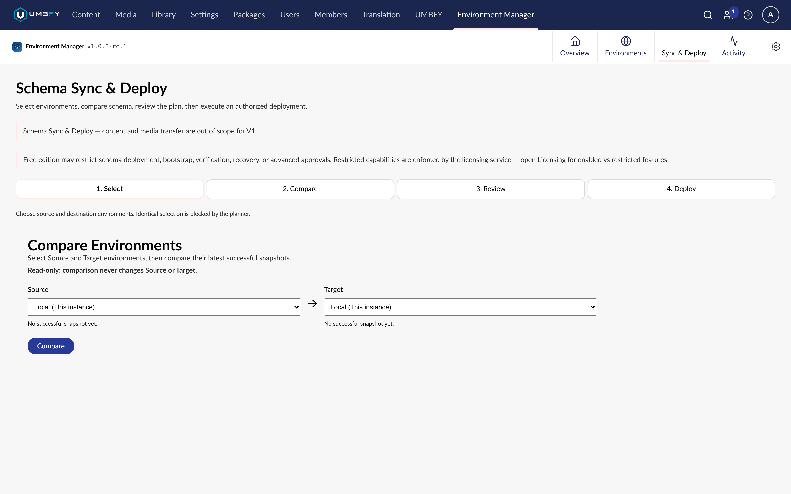

# Compare and Drift

**What it does.** Captures a schema snapshot of two environments, shows you the differences between them, and
detects drift against what you expected.

**When to use it.** Before planning any promotion, and as a routine check that environments have not diverged.

**Where to find it.** **Environment Manager → Sync & Deploy**, step **2. Compare**. An environment card on
**Overview** or **Environments** also has a **Compare** action.

**Required permissions.** The Environment Manager section.

**Edition.** Free — snapshots, compare and basic drift need no licence.

## Screenshots

Comparison is read-only — the screen states that it never changes Source or Target — and the planner blocks
selecting the same environment on both sides.

## What is compared

| Included | Not included |
| --- | --- |
| Document Types | Content |
| Element Types | Media |
| Data Types | Application binaries and NuGet packages |
| Templates | Database backups |
| Dictionary items | |
| Languages | |

## Step-by-step

1. Open **Environment Manager → Sync & Deploy**.
2. Choose the **source** environment and the **destination** environment.
3. Run the comparison. Both ends are snapshotted.
4. Read the differences before selecting anything.

## Understanding the result

Each difference tells you whether an item exists on one side only, or exists on both sides with different
definitions.

**Dependency mapping** is the part worth reading carefully. Schema items reference each other: a Document Type
depends on the Data Types its properties use, and on the Templates it allows. A single apparent difference may
legitimately pull others in with it, and promoting the Document Type without its Data Types would not produce
working schema.

**Impact assessment** classifies what a change would affect downstream, so you can tell a cosmetic difference from
one that reaches existing content.

## Drift

Drift is divergence you did not plan. The usual cause is somebody editing schema directly in the Backoffice on a
downstream environment — a quick fix in Staging that nobody brought back.

Basic drift detection is Free. Finding drift early matters because a promotion built on a drifted destination can
produce differences you did not intend to resolve.

A reasonable habit: compare Production against Staging on a schedule, not only when you are about to deploy.

## Snapshots

A snapshot is a point-in-time read of an environment's schema. Snapshots are what make comparison deterministic:
the plan you build later is built from a specific snapshot pair, not from whatever the environments happen to look
like when you press execute.

This is also why a plan can stop being executable — see
[Promotion](promotion.md#why-a-plan-stops-being-executable).

## Limitations

- Both environments must have the package installed and connectivity proven. See
  [Environments](environments.md).
- Comparison reads schema only. A difference in content is not reported, because content is out of scope.
- Large schemas take longer to snapshot. If a comparison times out against a distant peer, raise
  `ConnectionTimeoutSeconds` — see [Configuration](configuration.md#connectiontimeoutseconds).

## Related

- [Promotion](promotion.md)
- [Environments](environments.md)
- [Bootstrap](bootstrap.md) — when the destination is near-empty and difference-by-difference is the wrong tool
