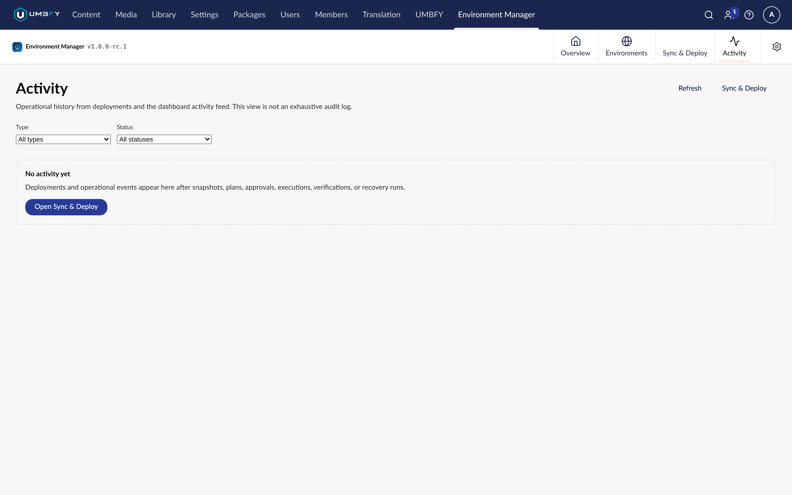

# Deployments

**What it does.** The history of every promotion, bootstrap and recovery run on this site, with live progress for
anything still running.

**When to use it.** While a run is in progress, to follow it; afterwards, to answer "what changed, when, and who
approved it".

**Where to find it.** **Environment Manager → Activity**.

**Required permissions.** The Environment Manager section.

## Screenshots

## The list

Deployments are listed newest first, with paging and filters so a long history stays usable.

| Column | What it tells you |
| --- | --- |
| Status | Where the run got to |
| Environment | Which destination it targeted |
| Started | When it began |
| Outcome | The result, once finished |

### Filters

Filter by destination environment, by status, and to **active runs only** when you want to see just what is in
flight.

### Active runs

A run is active while it is `Pending`, `Validating` or `Running`. Those three states are what the *active only*
filter selects. A run that has finished — successfully or not — is no longer active and appears in the full history
instead.

## Live progress

While a run is in flight the deployment view updates as it goes, so a long promotion does not look like a frozen
screen. You can leave the page and come back; progress is read from the run, not held in the browser.

## The audit trail

Open a deployment record to see the full story of that run:

- the plan that was executed, and its fingerprint
- the approval it was executed under
- the execution and its outcome
- the [verification](verification.md) result, if verification has been run
- any [recovery](recovery.md) assessment or execution against it

This is the evidence that a schema change was intended, approved and confirmed. If a record is missing its
verification, that promotion is unfinished — see [Verification](verification.md).

## Paging

The list pages server-side rather than loading everything, so history on a long-lived environment stays responsive.
Page size is selectable; the range of records shown is stated alongside the pager.

## Limitations

- Deployments records runs initiated **from this site**. A promotion initiated from a different source environment
  is recorded on that source.
- Removing the package does not delete deployment history.

## Related

- [Promotion](promotion.md)
- [Verification](verification.md)
- [Recovery](recovery.md)
