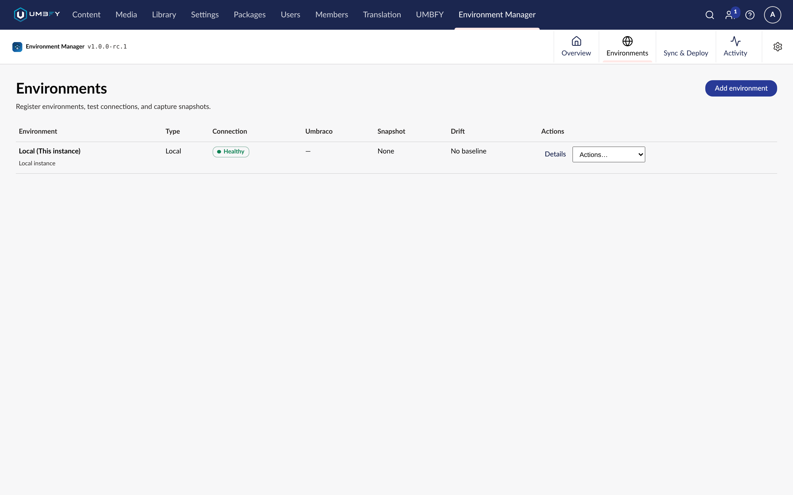

# Environments

**What it does.** Registers the other Umbraco environments this site can talk to, and proves connectivity to them.

**When to use it.** Once per peer, when you first set Environment Manager up, and again whenever a URL or API key
changes.

**Where to find it.** **Environment Manager → Environments**.

**Required permissions.** The Environment Manager section. Registering peers is an operations task.

**Edition.** Free — registering environments and running connection diagnostics needs no licence.

## Screenshots

## Environment types

Each site declares its own type through `LocalEnvironmentType`:

| Type | Typical use |
| --- | --- |
| `Local` | A developer machine |
| `Development` | A shared development environment |
| `Staging` | Pre-production validation |
| `Production` | Live |

`Production` is not a label. It is an explicit type that carries stronger acknowledgements before a promotion will
execute against it.

## Step-by-step: register a peer

1. Open **Environment Manager → Environments**.
2. Choose **Add**.
3. Enter the peer's URL. HTTPS is required unless the peer is localhost and `AllowHttpForLocalhost` is enabled
   there.
4. Enter the peer's identity — its `LocalIdentity`.
5. Supply the API key **that peer accepts**, which is the peer's own `RemoteApiKey`.
6. Save.
7. Choose **Test connection**.

A setup wizard walks you through the first peer.

## Understanding the result

A successful connection test means: the peer is reachable, it is running Environment Manager, the protocol versions
are compatible, and the API key was accepted. Only then can that peer take part in a comparison or receive a
promotion.

A failed test is a hard stop by design. Environment Manager will not attempt a promotion against a peer whose
connectivity has not been proven.

## Identity rules that matter

- `LocalIdentity` must be **unique per logical environment**. Two environments sharing an identity cannot be
  targeted reliably.
- A load-balanced site is **one** environment. All its nodes share one `LocalIdentity`. Giving each node its own
  identity breaks targeting and inflates your licensed site count.
- Changing an environment's identity after peers have registered it means re-registering it on those peers.

## Cluster awareness

On a multi-node site with a shared database, Environment Manager is aware that it is one of several nodes and fences
operations accordingly, so two nodes do not execute the same promotion. Multi-node support is architectural and was
exercised against a disposable Docker cluster; live cloud certification is not claimed.

Advanced cluster behaviour is a **Professional** capability.

## Limitations

- Both ends of a promotion must have the package installed, at the same version.
- Shared hosting is often partial or blocked for multi-node configurations.
- Peer communication requires HTTPS outside localhost.

## Troubleshooting

The three usual causes of a failed connection test:

1. The API key does not match the **destination's** `RemoteApiKey`.
2. The URL is HTTP and `AllowHttpForLocalhost` is not enabled on that peer — or the peer is not localhost, where
   HTTP is never permitted.
3. The peer is simply unreachable from this site — firewall, private network, or the site is not running.

See [Troubleshooting](troubleshooting.md).

## Related

- [Configuration](configuration.md)
- [Compare and Drift](compare-and-drift.md)
- [Security](security.md)
