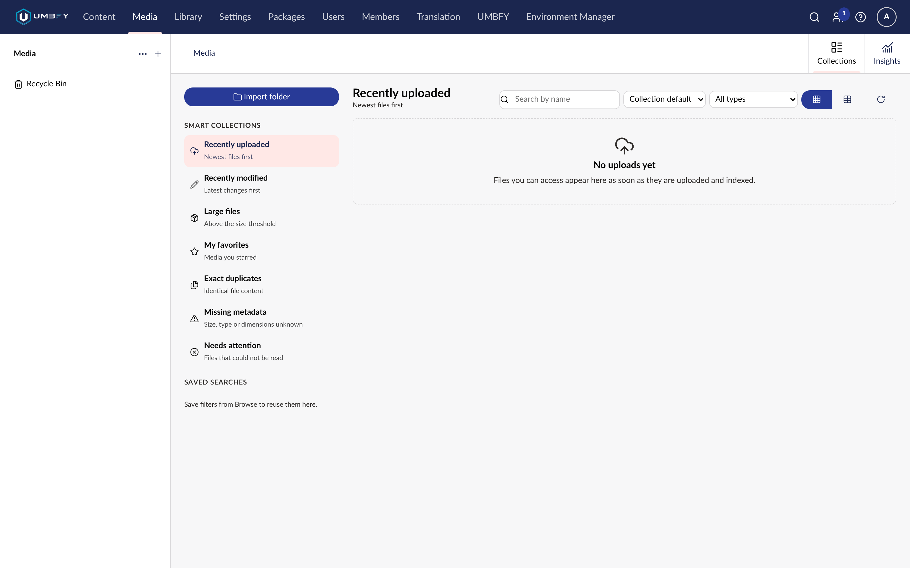

# Collections

**What it does.** The working surface of Media Order: virtual smart collections, your own saved searches, grid or
table view, bulk actions — and the place where the advanced filters actually run.

**Where to find it.** **Media → Collections**.

**Required permissions.** Media section access. Results are scoped to what you may see.

## Smart collections

Virtual collections computed from the metadata index, not folders you have to maintain:

| Collection | What it holds |
| --- | --- |
| **Recently uploaded** | The newest arrivals |
| **Large files** | Items over `LargeFileThresholdBytes` (10&nbsp;MB by default) |
| **Duplicates** | Byte-identical groups — see [Duplicates](duplicates.md) |
| **Missing metadata** | Items the index could not fully read |
| **Needs attention** | Items worth a look |

Nothing is moved or changed to populate these. They are queries, so an item can appear in several at once and
leaves a collection as soon as it no longer matches.

Turn them off with `SmartCollectionsEnabled` if you do not want them.

## Screenshots

## Saved searches

Build a filter you want again and save it. Saved searches are **per user**, so your experiments do not change what
your colleagues see.

This is where to put the queries your team actually runs — "images over 2 MB", "PDFs uploaded this quarter",
"anything with no dimensions" — rather than rebuilding them each time.

## Favourites

Per-user favourites, for the handful of items you keep coming back to. Filterable like anything else, so
"favourites, sorted by last modified" is a valid view.

Turn them off with `FavoritesEnabled`.

## Grid or table

Grid for recognising images; table for comparing sizes, dates and dimensions. Use the one that suits the question
you are asking.

## Why advanced filters live here

Browse is Umbraco's own media list with the Media Order toolbar on top. Collections is Media Order's own surface,
and the advanced filter query runs against the metadata index here.

If you build a filter in Browse, use **Apply in Collections** to carry it over. A filter in Browse that appears to
do nothing is this, not a fault.

## Step-by-step: build and save a working view

1. Open **Media → Collections**.
2. Start from a smart collection, or from an empty filter.
3. Add filters — type, extension, size, date, dimensions, aspect ratio, duplicates, missing metadata, favourites.
4. Choose grid or table.
5. Sort.
6. **Save the search** so you can return to it.

## Bulk actions from here

Selecting items in Collections gives you [bulk operations](bulk-operations.md) — rename with a preview, move, and
favourite add or remove. Per-item authorization applies throughout.

## Understanding the result

**A smart collection that looks short.** Either the metadata index is still warming up — check
[Insights](insights.md) — or you are a user with a restricted media start node, in which case you see only your own
folders and totals are labelled as scoped.

**"Potentially unused" returning nothing.** That query needs [Content Guard](../content-guard/README.md). Without
it, Media Order returns empty rather than inventing usage it cannot determine.

## Limitations

- Advanced filters depend on the metadata index. With `MetadataIndexingEnabled` off, the filter surface is reduced.
- Saved searches are per user and are not shared with the team.
- `MaxPageSize` bounds a page of results. Default 100, ceiling 200.

## Related features

- [Sorting and Filtering](sorting.md)
- [Bulk Operations](bulk-operations.md)
- [Duplicates](duplicates.md)
- [Insights](insights.md)
